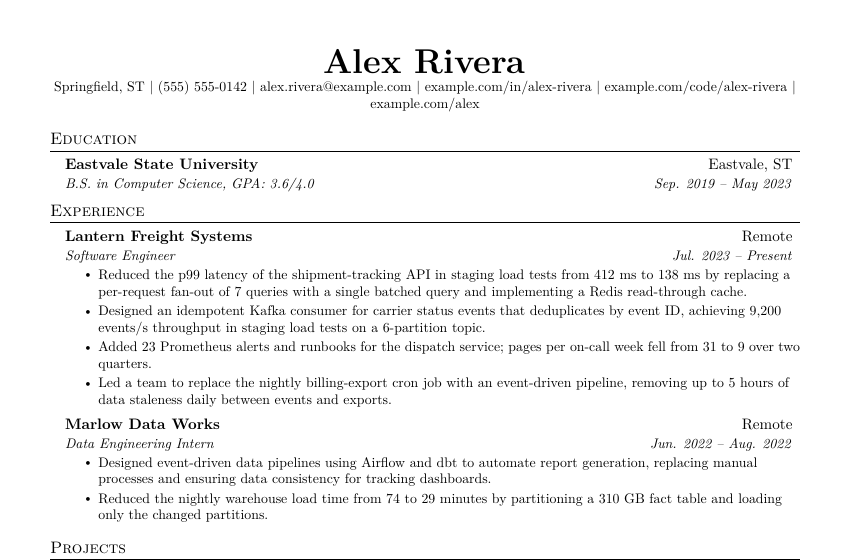

# jd-resume-tailor

Tailors a one-page resume to a job description from a bank of facts. Every rewritten bullet is
checked against the facts it cites, and one that fails twice is replaced by the bank's own sentence.

The idea: every bullet of a tailored resume must trace back to a fact you wrote down, and a
program, not the model's good intentions, checks each rewrite for numbers, technologies and claims
its facts do not hold. Rewriting is where tailoring tools invent things (0.875 becomes 88%,
at-least-once becomes exactly-once), so the checker is the point of the project.

## Status

<!-- measured:begin status
  eval/pipeline/results.json#protocol
  eval/pipeline/results.json#scores.bullets.rewritten
  eval/pipeline/results.json#scores.gate_off.flagged
  eval/pipeline/results.json#scores.gate_off.structural
  eval/pipeline/results.json#scores.gate_on
  eval/pipeline/results.json#scores.per_resume.input_tokens.median
  eval/pipeline/results.json#scores.per_resume.output_tokens.median
  eval/pipeline/first-rewrites.json#confidence_percent
  eval/pipeline/first-rewrites.json#violation_rate.percent
  eval/pipeline/first-rewrites.json#violation_rate.interval_percent
  eval/pipeline/residual.json#residual.percent
  eval/pipeline/residual.json#residual.interval_percent
  eval/usage.json
-->
The tool runs end to end, from a job description to a one-page PDF, and every bullet it puts on a
resume either passed the verifier or is the bank's own sentence. Measured on a local model
(`qwen3:8b`) over 12 postings and 3 seeds, 36 runs, the gate cut how often a rewritten bullet
overstates its facts: by labels from the facts on a sample of each, about 32% of the model's first
rewrites carried a violation (95% interval 21.3% to 44.2%), and about 9% of the rewritten bullets
that passed the gate do (95% interval 5.4% to 17.3%). Of the 442 first rewrites, 203 passed the
verifier and it stopped 238 before they could reach a resume (1 more cited no fact of its entry); a
retry rescued 122 of those, and the other 117 went back to the bank's own wording. A resume costs a
median of 27,885 input and 2,114 output tokens, which is nothing on a local model. Its private
predecessor has produced 542 resumes (2026-03 to 2026-11).

| What works |
| --- |
| The fact-bank format, loading and validation, `tailor bank check` |
| The verifier: `tailor verify` checks bullets against the facts they cite |
| A labelled dataset and `tailor eval verifier`, gated in CI |
| Model providers (Anthropic, any OpenAI-compatible endpoint) with record and replay, and a seed where the provider takes one |
| `tailor plan`: job description, selection, rewriting behind the verifier |
| `tailor render` and `tailor run`: LaTeX, layout checks, a fit to one page |
| `tailor judge`: a second reader that checks a bullet against its facts, measured next to the verifier |
| `tailor eval pipeline`: the pipeline over 12 postings and 3 seeds; CI re-scores every committed run and replays one from its cassettes |

The full record of the measurement, both labellings included, is in
[eval/pipeline/README.md](eval/pipeline/README.md).
<!-- measured:end -->

## Try it

You need [uv](https://docs.astral.sh/uv/) and Python 3.12 or newer.

```sh
uv sync
uv run tailor bank check examples/alex-rivera/bank.json
```

That prints a summary of the example bank, an invented person's work and projects:

```text
ok: examples/alex-rivera/bank.json
entries       13 (work: 3, project: 10)
candidates    11 (work: 3, project with code: 8)
facts         65 (49 from bullets, 12 from scope, 4 explicit)
do not claim  54 claims in 13 entries
same project  1 group
  gridlock, gridlock-bench
warnings      none
```

A bank that breaks the format exits with status 1 and lists every problem with its path:

```text
invalid fact bank in my-bank.json: 2 problems
  $.experiences[0].id: required property is missing
  $.experiences[1].bullet_capabilities: has 2 items but there are 1 bullets; it needs one label per bullet
```

## Plan a resume

`tailor plan` reads a job description, chooses the entries and bullets that fit it, rewrites them
from the facts they cite, and keeps only what the verifier passes:

```sh
uv run tailor plan --jd examples/alex-rivera/jds/backend-engineer.txt \
  --bank examples/alex-rivera/bank.json --profile examples/alex-rivera/profile.json \
  --out plan.json
```

`--jd` is a text file or a URL. A Greenhouse, Lever or Ashby job URL is read through that board's
public JSON API; any other URL is fetched and reduced to text. The command writes `plan.json` and a
Markdown provenance report next to it (`plan.md`) and exits 0 when it has.

What happens, in order:

1. **Extract.** One model call turns the posting into title, company, responsibilities,
   requirements, nice-to-haves and keywords.
2. **Select.** One model call scores each candidate entry (every work entry, and projects with code)
   against the responsibilities. Everything after that is deterministic: two to three work entries
   and two to three projects that cover different responsibilities, never both halves of one
   project, each keeping two to four bullets in the order the model ranked them. Ties go to the
   smaller entry id.
3. **Rewrite.** One call per entry returns each bullet with the fact ids it cites. The prompt states
   the rules (no new numbers, technologies, absolutes or causes; round only the unflattering way;
   use the posting's words only where accurate), but the verifier enforces them. A bullet that
   fails the verifier, cites no fact, or cites a fact the entry does not have gets one retry, in
   which the model is shown what was wrong. If the retry fails too, the bank's own bullet is used
   and the plan records why. An entry with `adaptable: false` is copied without a model call.

The model is not chosen for you. Set it with `--model` and `--provider`, with `TAILOR_MODEL` and
`TAILOR_PROVIDER`, or in a `tailor.toml`; with none of them the command stops and says how.

```toml
[llm]
provider = "openai"                     # "anthropic", or "openai" for any OpenAI-compatible endpoint
model = "qwen3:8b"                      # a model id from your provider, or from `ollama list`
base_url = "http://localhost:11434/v1"  # openai provider only; this is a local Ollama
```

The Anthropic provider needs `ANTHROPIC_API_KEY`; an OpenAI endpoint needs `OPENAI_API_KEY` unless
it is local. No sampling parameters are sent. For Anthropic the answer comes back as the input of
one tool whose schema is the target schema; the Opus 5.5 and Sonnet 5.5 generations reject a forced
tool choice, so for those the request uses `auto` with a strict tool and an instruction to call it.

`TAILOR_CASSETTES=record` writes every model call to a file in `TAILOR_CASSETTE_DIR` (named by the
hash of the request); `replay` answers from those files with no model and no network, and says which
hash is missing if a prompt has changed. The recorded run in `examples/alex-rivera/` replays with:

```sh
TAILOR_CASSETTES=replay TAILOR_CASSETTE_DIR=examples/alex-rivera/cassettes \
TAILOR_PROVIDER=openai TAILOR_MODEL=qwen3:8b \
  uv run tailor plan --jd examples/alex-rivera/jds/backend-engineer.txt \
  --bank examples/alex-rivera/bank.json --out plan.json
```

## Render a resume

`tailor run` plans as above and then renders the plan to a one-page PDF:

```sh
uv run tailor run --jd examples/alex-rivera/jds/backend-engineer.txt \
  --bank examples/alex-rivera/bank.json --profile examples/alex-rivera/profile.json \
  --out out/
```

It writes `resume.tex`, `resume.pdf`, `plan.json` and `provenance.md` (the plan's report plus what
was dropped to fit) to `--out`. `tailor render --plan plan.json --profile profile.json --out out/`
renders an existing plan with no model. Both need `pdflatex` (or `xelatex`) on the path and say how
to install one when there is none; poppler's `pdftotext` is optional and switches on the layout
checks that read the PDF. The recorded run replays offline (set `TAILOR_CASSETTES=replay`,
`TAILOR_CASSETTE_DIR=examples/alex-rivera/cassettes`, `TAILOR_PROVIDER=openai` and
`TAILOR_MODEL=qwen3:8b`); its output is in [`examples/alex-rivera/out/`](examples/alex-rivera/out/):



What the renderer does, and does not:

- **The template** is [Jake Gutierrez's resume template](https://github.com/sb2nov/resume) (MIT, the
  attribution and licence are kept in the file), with placeholders in place of the body. It holds no
  text to escape: every string from the plan or the profile goes through one tested function
  (`escape_latex`, or `escape_url` for links) as it is placed. The profile is plain text, not LaTeX.
  Its coursework, activities and awards are not rendered.
- **The engine** is pdflatex, retried with xelatex if the first fails on a font or a Unicode
  character.
- **The checks** read the log (page count, overfull boxes), the PDF (bullet gaps, bullets that wrap,
  how full the page is, whether the text extracts for an ATS) and the plan (bullets of one entry
  that start with the same word). The provenance report prints them.
- **Fitting.** If the PDF is over one page, the last bullet of an entry (the selection ranked them,
  most useful first) is dropped, from the lowest-scoring entry that still has more than two; when
  every entry is down to two, whole entries go, lowest score first, and the last work entry stays.
  The PDF is rebuilt after each drop, and the provenance report lists every drop in order with its
  reason. A bullet is never shortened or reworded, since a reworded bullet would not have passed the
  verifier. `--one-line-bullets` also drops until no bullet wraps, which most real bullets do (every
  bullet of the example resume wraps), so it is off by default and only reported.
- **Not done.** The page is never filled: if the plan is short the page stays short, and no bullet
  is added back. `fit` cannot help a plan whose two-bullet entries already overflow; it then exits
  1 and says so.

## The fact bank

A bank is a JSON file with a list of `experiences`, each a `work` or a `project` entry with an id,
a title, bullets and, optionally, a `scope`. The format is defined by
[`src/tailor/bank/bank.schema.json`](src/tailor/bank/bank.schema.json) and the
[example](examples/alex-rivera/README.md) shows it in use. Three conventions matter:

- **Bullets are facts.** Each bullet of an entry is something a resume may restate, and the
  sentence the tool falls back to when a rewrite fails verification. An entry may instead list
  structured `facts` with their numbers.
- **`DO NOT CLAIM:` in a scope** lists what the bullets must not be stretched into, one claim per
  semicolon or sentence.
- **`Same project as <id>`** in a scope marks entries that describe one project, so a resume does
  not list it twice.

Unknown fields are errors, on purpose: a misspelled `scope` would otherwise be ignored without a
word, and the scope is where the limits live.

## Verify bullets

`tailor verify` checks bullets against the facts they cite and says what is not supported:

```sh
uv run tailor verify --bank examples/alex-rivera/bank.json --bullets bullets.json
```

```json
[
  {"entry": "gridlock", "sources": ["gridlock#2"],
   "text": "Handled 41,000 checks/s with a p99 of 2.1 ms at 20,000 checks/s."},
  {"entry": "tidekv", "text": "Reached 18,000 writes/s by group-committing writers."}
]
```

Each bullet names its bank entry and, optionally, the fact ids it cites (without them every fact of
the entry is a source). The exit status is 0 when every bullet is ok, 1 when one is not, and 2 when
the check could not run. `--format json` gives the report as JSON; `--rounding nearest` relaxes the
number rule to ordinary rounding at two significant figures.

Six kinds of finding, each with the offending span and the evidence:

| Finding | Meaning |
| --- | --- |
| `fabricated_number` | a number with no match in the sources, in the same unit family |
| `number_drift` | a number that matches only by rounding the flattering way (0.875 as 88%, 29.5 s as 29s, `8K+` for exactly 8,000, `up to 3.1x` from 3.08x, "reduced latency by 41%" from 40.6%) |
| `fabricated_entity` | a technology or proper noun in neither the sources nor the entry's tech stack |
| `do_not_claim` | the bullet repeats an item of the entry's `DO NOT CLAIM:` list |
| `escalation_absolute` | `guaranteed`, `never`, `exactly-once`, `100%`, `every`... that no source uses |
| `escalation_causal` | a "by X" or "so that" whose cause and result no source states together |

The rounding rule is directional: a number may be rounded the unflattering way only. For a
higher-is-better value (a throughput, a share) that is down: 0.875 may be 87%, not 88%. For a
lower-is-better value (a latency, a duration, a size) it is up: 29.5 s may be 30 s, not 29s. Which
one a number is comes from its unit and the words around it, a heuristic. A percentage that is the
size of a reduction ("reduced p99 latency by 41%", "41% fewer", "a 41% reduction") is the
exception: it is how much was saved, so higher flatters whatever it is a reduction of, and 40.6%
may be 40%, not 41%.

Three more rules decide what a fact can support:

- **A number is bound to its claim.** A bullet number must share a metric word with the fact it
  matches: the words around the number in the bullet (`p99 latency`), without numbers, units,
  generic verbs, the first word, or what follows a `by`, `through` or `thanks to`. `Cut p99 latency
  from 412 ms to 11 minutes` fails even though `11 minutes` is the deploy time of another fact of
  the entry. It is word overlap, so a bullet that names the metric in other words than the fact
  (`response time` for `latency`) is flagged too, and it cannot tell two numbers of one fact apart.
- **A scope is context, not an achievement.** A scope records provenance and test conditions. Its
  numbers cannot be the source of a bullet's numbers (`Handled 200 req/s in production` from a
  note about a 200 req/s test fails); it still backs names, absolutes, causes and the DO NOT CLAIM
  limits.
- **`production` and `led the team` need a fact.** A bullet that says `production`, or that it led
  or managed a team, is flagged when no cited fact says so (a fact that says "not production" does
  not). It is a `do_not_claim` finding when the entry's DO NOT CLAIM list rules out production,
  deployment or real users, and an `escalation_absolute` finding otherwise.

The first four checks are rules; the two escalation checks are heuristics over word lists and word
overlap, and the evaluation reports them separately.

## Judge bullets

`tailor judge` asks a model the verifier's six questions about each bullet, against the facts it
cites, and gives a short reason. It uses the same provider layer and the same bullets file as
`tailor verify`:

```sh
uv run tailor judge --bank examples/alex-rivera/bank.json --bullets bullets.json
```

The judge is a second reader, not an authority: `tailor eval judge` scores it per class next to the
verifier on the same labelled rows, and the results are below.

## How well it works

<!-- measured:begin verifier
  eval/verifier/results.json#dataset.rows
  eval/verifier/results.json#dataset.holdout
  eval/verifier/results.json#holdout.classes
  eval/verifier/history.json#dataset
  eval/verifier/history.json#holdout_before
  eval/verifier/history.json#holdout_after
-->

`tailor eval verifier` runs the verifier on 306 labelled bullets over the invented bank (89 of the
200 violations adapted from overclaim patterns found when checking real resume bullets against
their source repositories), with 84 rows held out (drawn once from the first 274 by a seeded hash,
recorded in `split.json`) and the rules tuned on the rest. Rows added later go to dev, so the
holdout does not change. "Before" is the first version of the verifier (the numbers committed at
83f1a0f); "after" is the version after an independent review of it, which fixed how percent
reductions round, bound each number to the claim it supports, kept scope notes out of the sources
for numbers, and flagged `production` and `led the team` that no fact states. Holdout, 84 rows:

| Class | Before: precision / recall | After: precision / recall |
| --- | --- | --- |
| fabricated_number | 1.00 / 1.00 | 1.00 / 1.00 |
| number_drift | 1.00 / 1.00 | 1.00 / 1.00 |
| fabricated_entity | 1.00 / 1.00 | 1.00 / 1.00 |
| do_not_claim | 1.00 / 0.56 | 1.00 / 0.67 |
| escalation_absolute | 1.00 / 1.00 | 1.00 / 1.00 |
| escalation_causal | 1.00 / 1.00 | 1.00 / 1.00 |

Any violation caught: 0.88 (50 of 57) before, 0.91 (52 of 57) after. Faithful bullets flagged: 0
of 27 before and after. No class got worse, so the CI gate holds the "after" numbers. The holdout
is small (5 to 18 rows per class) and the same person wrote the rules and the rows, so treat these
as an upper bound; the dev numbers are lower for escalation and do-not-claim. The weak spot is
`do_not_claim`, which fires when a bullet repeats the words of a limit, or says `production` with no
fact behind it. See [eval/verifier/README.md](eval/verifier/README.md) for how the rows were made,
the dev numbers and what the verifier cannot see. CI fails if a later change makes the holdout
numbers worse.
<!-- measured:end -->

### A blind set

<!-- measured:begin blind
  eval/verifier/blind/results.json#rows
  eval/verifier/blind/results.json#judgement_calls.rows_in_the_set
  eval/verifier/blind/results.json#first_run.scores.classes
  eval/verifier/blind/results.json#first_run.scores.caught_violation_recall
  eval/verifier/blind/results.json#rescored.scores.classes
  eval/verifier/blind/results.json#rescored.scores.caught_violation_recall
  eval/verifier/history.json#blind_before
  eval/verifier/history.json#blind_after
-->

Because the rules and the main dataset have one author, a second author wrote 86 more rows from
the bank and the label definitions alone, without seeing the verifier, and the verifier was run on
them once, at 492a3fa ([eval/verifier/blind/](eval/verifier/blind/)). The set was **re-scored, not
re-labelled** after the review's fixes: no label was changed, and the figures of the bank were
substituted in the rows' sources and bullets in the same way as in the bank. It is not used to
tune the verifier and not part of the CI gate. Before is that first run, after is the re-score:

| Class | Before: precision / recall | After: precision / recall |
| --- | --- | --- |
| fabricated_number | 0.59 / 0.83 | 0.48 / 0.83 |
| number_drift | 0.89 / 0.89 | 0.89 / 0.89 |
| fabricated_entity | 1.00 / 1.00 | 1.00 / 1.00 |
| do_not_claim | 1.00 / 0.31 | 1.00 / 0.31 |
| escalation_absolute | 0.79 / 0.85 | 0.73 / 0.85 |
| escalation_causal | 0.50 / 0.64 | 0.50 / 0.64 |

Any violation caught: 0.85 (50 of 59) before, 0.86 (51 of 59) after. Faithful bullets flagged: 8 of
27 before, **11 of 27** after. The new rules added five findings on blind rows: four
`fabricated_number` (three on faithful rows, one on a violating row of another class) and one
`escalation_absolute` (on a violating row of another class). Of the three faithful rows that now
alarm, two are number binding (a number whose metric the bullet names in other words than the
fact) and one is a number the bullet took from a scope note. That is why precision fell in those
two classes and nothing else moved. These are the numbers to expect on
phrasing the rules were not written for; to reproduce them (the command scores every row, writes
nothing, and is not used by the gate):

```sh
uv run tailor eval verifier --data eval/verifier/blind --score-only
```

What it still gets wrong there (the review's fixes did not touch the first five; the last is new):

- A number the bullet derives from its sources, such as a speed-up computed from two durations, is
  reported as fabricated.
- The causal check flags a mechanism the source does state, and misses one in a trailing clause
  (`thanks to ...`, `and cutting ...`).
- A limit in other words than the `DO NOT CLAIM` item's is not recognised.
- `every` and `eliminating` in a harmless sense are taken for absolutes.
- A technology from the entry's tech stack passes the entity check even where no fact connects it
  to the claim: a local-model run kept "using GitHub Actions for CI pipelines" on a project whose
  facts never mention CI.
- Number binding is word overlap: it flags a number whose metric is named in other words than the
  fact's, and it passes a number that belongs to another claim of the same fact.

13 of the 86 blind rows were judgement calls for their author, so some disagreements are about the
label rather than the verifier.
<!-- measured:end -->

### The plan, on a small local model

<!-- measured:begin plan
  examples/alex-rivera/plans/backend-engineer.plan.json#summary
  examples/alex-rivera/plans/backend-engineer.plan.json#usage
-->

One run, recorded in `examples/alex-rivera/cassettes` and replayed by CI: `tailor plan` with
`qwen3:8b` through Ollama, on the invented bank and `jds/backend-engineer.txt`. It chose two work
entries and two projects, 10 bullets, and made 10 model calls (24,406 input and 1,470 output
tokens):

| Outcome | Bullets |
| --- | --- |
| Passed the verifier first time | 5 |
| Passed after one retry that showed the model its findings | 4 |
| Fell back to the bank's own wording | 1 |

The plan and the provenance report of that run are in `examples/alex-rivera/plans/`. This is one
posting, one run, one small model: it shows that the gate works end to end (a rewrite that tied
the drop in on-call pages to a cause no fact states went back to the bank's sentence after two
attempts), not how often a given model fabricates. The run was recorded again after the verifier
and the example bank changed, so it differs from the first one. "Passed" means the verifier found
nothing; the verifier does not catch everything (see above), so a passed bullet can still be a
looser paraphrase than you would write. The measured rates with and without the gate, over the
whole evaluation, follow.
<!-- measured:end -->

### The whole pipeline, measured

<!-- measured:begin pipeline
  eval/pipeline/results.json#protocol
  eval/pipeline/results.json#scores.bullets.rewritten
  eval/pipeline/results.json#scores.gate_off
  eval/pipeline/results.json#scores.gate_on
  eval/pipeline/results.json#scores.per_resume.calls.median
  eval/pipeline/results.json#scores.per_resume.input_tokens.median
  eval/pipeline/results.json#scores.per_resume.output_tokens.median
  eval/pipeline/blind-sample-map.json#strata
  eval/pipeline/residual.json#confidence_percent
  eval/pipeline/residual.json#labelled
  eval/pipeline/residual.json#random.violations
  eval/pipeline/residual.json#census.confirmed
  eval/pipeline/residual.json#residual
  eval/pipeline/first-rewrites.json#frame
  eval/pipeline/first-rewrites.json#sampled
  eval/pipeline/first-rewrites.json#violation_rate.violating
  eval/pipeline/first-rewrites.json#violation_rate.percent
  eval/pipeline/first-rewrites.json#violation_rate.interval_percent
  eval/pipeline/first-rewrites.json#gate_off_flag.flagged_violating
  eval/pipeline/first-rewrites.json#gate_off_flag.false_alarms
  eval/pipeline/first-rewrites.json#gate_off_flag.ok
  eval/pipeline/first-rewrites.json#overlap_with_passed_sample.rows
  eval/pipeline/citations.json#first_rewrites.fabricated_number_only_id_digits
-->

`tailor eval pipeline` ran `tailor plan` over the example bank, 12 invented postings and 3 seeds
(36 runs, 442 bullets) with `qwen3:8b` through Ollama, recording every model call. The protocol was
committed before the first call and the results come from a clean tree
([eval/pipeline/](eval/pipeline/README.md)). In every run the first rewrite of each bullet went to
the gate: it passed the verifier, was flagged by it, or (once) cited no fact of its entry and never
reached it. A bullet that did not pass was retried once, and kept or replaced by the bank's own
wording:

| Outcome | Bullets |
| --- | --- |
| First rewrite passed the verifier | 203 of 442 |
| First rewrite flagged by the verifier (what a run without the gate would have kept) | 238 of 442 |
| First rewrite cited no fact of its entry (structural) | 1 of 442 |
| Passed after one retry that showed the model what was wrong | 122 |
| Fell back to the bank's own wording | 117 |

What the verifier flagged in those 238 first rewrites, by class: `escalation_causal` 152,
`fabricated_number` 107, `fabricated_entity` 12, `escalation_absolute` 8, `do_not_claim` 3,
`number_drift` 1 (a rewrite can carry more than one). In 65 of the 107 `fabricated_number` flags,
the number flagged is only the digit of a fact id the model copied into its text. Every final bullet
passed the verifier or is the bank's sentence. A resume took a median of 10 model calls and 27,885
input and 2,114 output tokens; the cost of a local model is zero.

To measure what the verifier lets through, 94 of the 325 final bullets that passed it were
labelled blind from the facts: the 34 the judge flagged and 60 drawn at random from the other 291.
The labels put 14 of the 94 as violations, 10 of them among the flagged and 4 among the random 60.
That estimates 29.4 violating bullets among the 325 that were rewritten and passed: 9.0% of them
(95% interval 5.4% to 17.3%), so about 91% are faithful. A second labelling from the facts, of 60 of
the 441 first rewrites drawn at random, puts 19 of them as violations: 31.7% (95% interval 21.3% to
44.2%). The verifier flagged 16 of those 19, and 12 of the 41 that are faithful. 13 of the 60
repeat bullets of the first sample, so for those the labelling was not blind to the verdict; the
record gives the figures without them too.

The judge (`qwen3:8b`) was measured on the verifier's holdout and on the blind set, next to the
verifier. The per-class tables of both, the judge's flags on the final bullets and the blind
labelling are in [eval/pipeline/README.md](eval/pipeline/README.md).

<!-- measured:end -->

## Development

```sh
bash scripts/preflight.sh
```

runs the hygiene check, ruff, mypy in strict mode and the tests. The tests that compile a PDF are
marked `requires_tex` and skip, with the reason, when `pdflatex` or `pdftotext` is missing; CI
runs them in a `render` job. See [CONTRIBUTING.md](CONTRIBUTING.md).

## License

[MIT](LICENSE).
